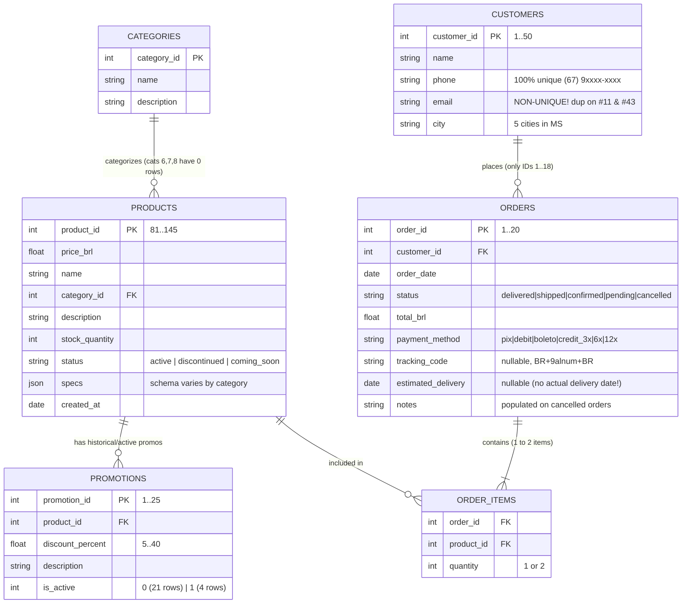
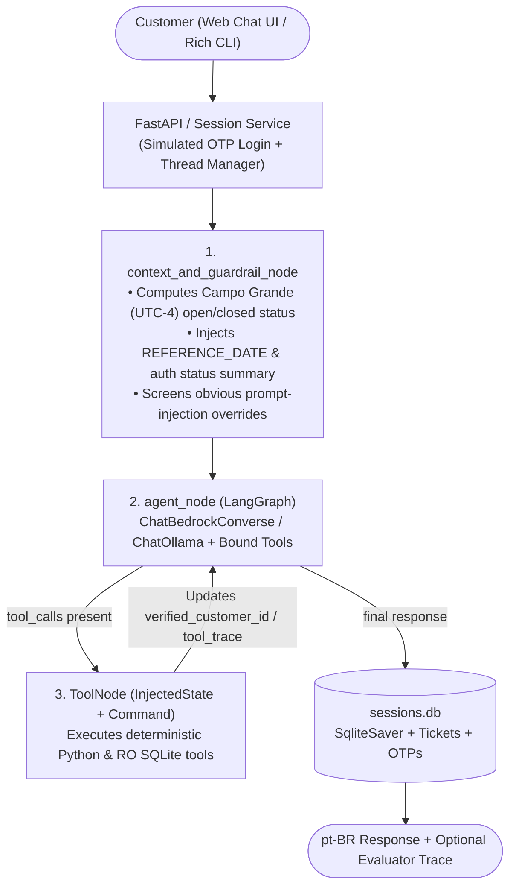
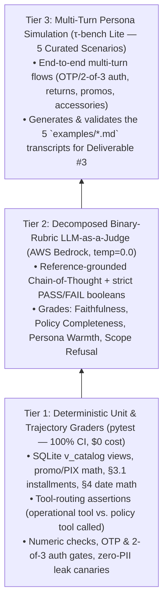

# Engineering Plan, Data Exploration & SOTA Literature Review

> **Status note (2026-11-03):** this is the original plan, kept as written for the record. Several choices were changed after the adversarial review in [`Plan_Review.md`](Plan_Review.md) (policy retrieval, LLM provider, interface, authentication, evaluation). The final design and the reasons are in the README sections *Decisões técnicas* and *Uso de assistentes de código*.

## Take-Home Challenge — AI Engineer (Artefact) · *Empório da Música*

> **Purpose of this document:** This engineering design document records (1) the forensic Exploratory Data Analysis (EDA) of all provided operational CSVs and policy manual, (2) a literature review of the 2023–2026 State of the Art (SOTA) in tool-augmented customer-service agents, retrieval, guardrails, and evaluation, (3) all finalized, justified architectural decisions resolved during design review across framework, LLM runtime, UI, authentication, data engineering, and testing, and (4) an incremental execution & Git commit plan.
>
> Final customer-facing prompts, UI copy, example conversations, and the deliverable `README.md` will be written in Brazilian Portuguese (`pt-BR`) as required by the brief.

---

## Table of Contents

1. [Executive Summary & Finalized Decision Matrix](#1-executive-summary--finalized-decision-matrix)
2. [Challenge Scope & Evaluation Lens](#2-challenge-scope--evaluation-lens)
3. [Phase 0: Exploratory Data Analysis (EDA) & Policy Audit](#3-phase-0-exploratory-data-analysis-eda--policy-audit)
4. [Literature Review: Current State of the Art (2023–2026)](#4-literature-review-current-state-of-the-art-20232026)
5. [Data Organization Strategy: Raw vs. Curated Layer](#5-data-organization-strategy-raw-vs-curated-layer)
6. [Framework, LLM Runtime, UI & Tooling Architecture](#6-framework-llm-runtime-ui--tooling-architecture)
7. [Evaluation Strategy: Code Graders vs. LLM-as-a-Judge](#7-evaluation-strategy-code-graders-vs-llm-as-a-judge)
8. [Documented Assumptions & Policy Reconciliations](#8-documented-assumptions--policy-reconciliations)
9. [Phased Implementation & Incremental Git Commit Plan](#9-phased-implementation--incremental-git-commit-plan)
10. [References](#10-references)

---

## 1. Executive Summary & Finalized Decision Matrix

| Decision Area | Locked-In Choice | Alternatives Considered | Core Engineering Justification |
| :--- | :--- | :--- | :--- |
| **Agent Framework & Topology** | **LangGraph** (`StateGraph`): **Unified Stateful Tool-Calling Graph** (`Context/Guardrail Node` $\rightarrow$ `Agent Node` $\leftrightarrow$ `ToolNode` with `Command` + `InjectedState` + `SqliteSaver`) | Multi-agent router/supervisor graph; legacy LangChain `AgentExecutor`; raw SDK loop | Handles multi-intent WhatsApp messages (e.g., price + shipping + return policy in one turn) via parallel tool calls without supervisor handoff latency; `InjectedState` enforces LGPD auth outside LLM-guessable arguments; `SqliteSaver` gives durable multi-turn persistence. |
| **LLM Provider & Hardware Strategy** | **Dual-Provider Model Factory** (`LLM_PROVIDER` in `.env`): **AWS Bedrock** (`ChatBedrockConverse` — Claude Haiku/Sonnet or Amazon Nova Pro) **+ Local Ollama** (`qwen3:8b` / `qwen2.5:7b` quantized for local **RTX 4070 8 GB VRAM**) *(+ optional OpenAI/Gemini fallback for evaluators)* | Cloud-only single vendor; 100% local 8B for both agent and judge | AWS Bedrock satisfies enterprise LGPD governance (zero training on customer PII, IAM isolation) and powers reliable `pt-BR` synthesis + LLM-as-a-Judge; Ollama 8B fits cleanly inside the local 8 GB VRAM GPU for zero-cost offline dev/testing. |
| **Data Organization & Cleaning** | **Two-Layer Non-Destructive Pipeline**: `git mv` raw inputs to `data/raw/` $\rightarrow$ deterministic `build_data.py` $\rightarrow$ **SQLite (`data/processed/emporio.db`)** with `v_catalog` view & `has_catalog_inconsistency` flags | Querying space-prefixed CSVs with `pandas` at runtime; overwriting/fabricating conflicted SKU descriptions; external Postgres | Preserves raw CSV auditability while pre-joining `is_active=1` promos, non-cumulative PIX prices, `status='active' AND stock_quantity > 0` availability, NFKD accent-free search, and metadata conflict warnings on `IDs 135–144`. |
| **Policy Retrieval** | **Section-Aware Structured Markdown (`policies_structured.md`) + SQLite FTS5 (`bm25`)** behind `consult_store_policy` | Fixed-size PDF chunking + dense vector DB (Chroma/Qdrant); tool-free prompt stuffing only | `políticas_da_loja.pdf` is **1,753 words (~2,350 tokens)** across §1–§10. Keeping logical sections intact prevents splitting §3 tables from §3.1 exceptions (CAG SOTA), runs in <1 ms with zero PyTorch bloat, and keeps policy consultation observable as a tool call. |
| **Customer Auth & LGPD Gate** | **Hybrid Dual-Path Auth**: (1) **Simulated OTP Login** in the Web UI for logged-in customers + (2) **Conversational 2-of-3 Verification** (`Order ID`, `E-mail`, `Phone`) for unlogged chat visitors | Single-factor email or sequential `order_id` lookup | Blocks `1..20` order ID enumeration, resolves the `bruno.martins@jmail.com` duplicate-email collision (`#11` vs. `#43`), supports customers who forgot their order ID (`Email + Phone`), and documents real SMS/email OTP (AWS SNS/SES) under Known Limitations. |
| **Action & Mutation Scope** | **Read-Only Operational DB (`emporio.db`) + Structured Ticket/Protocol Creation (`EMP-2026-XXXX` in `sessions.db`)** | Mutating `orders.status` directly in seed DB; purely passive "email us" replies | Keeps catalog/order data 100% idempotent for repeated evaluation runs while letting verified customers open actionable Return (§4), Warranty (§8), Cancellation, or Complaint (§7.3, 24h SLA) protocols after confirmation. |
| **Customer UI & CLI** | **FastAPI + Bespoke *Empório da Música* Web Chat** (zero-npm HTML/CSS/JS, PDF brand palette, WhatsApp UX, starter chips, MS hours badge, toggleable **Evaluator Inspector Drawer**) **+ Rich CLI** | Streamlit; Chainlit default layout; CLI-only | Delivers an intuitive, zero-friction storefront chat experience for real customers while giving Artefact reviewers a 1-click drawer to inspect LangGraph tool traces, auth state, and `.md` exports—with zero Node/npm build steps and Python as the core codebase. |
| **Clock & Timezone** | **Real Wall-Clock Default in `America/Campo_Grande` (UTC-4)**, with `.env` (`REFERENCE_DATE`) & UI Evaluator Drawer override for historical return-window demos | Hardcoding March 2026 silently; blocking automated answers outside business hours | Matches real Mato Grosso do Sul local time (`UTC-4`, 1h behind Brasília) out of the box, answers 24/7 while noting human return hours outside §2 operating windows, and allows deterministic time-travel testing on Feb/Mar 2026 CSV orders. |
| **Evaluation Strategy** | **3-Tier Hybrid Pyramid**: (1) Deterministic `pytest` code & trajectory graders, (2) **Binary-rubric CoT LLM-as-a-Judge** (`temp=0.0`, via Bedrock), (3) Multi-turn persona simulations | Standalone 1–5 Likert LLM-as-a-Judge; manual chat testing only | Code graders guarantee 100% precision on prices, promos, stock, routing, and PII non-leakage; decomposed boolean LLM judges grade tone, empathy, and policy completeness without Likert central-tendency drift. |
| **Git & Repo Workflow** | **Transparent Incremental History**: Commit #1 (`PLAN.md` + `CLAUDE.md`), Commit #2 (`git mv` to `data/raw/` + `uv` setup), followed by 6 atomic feature/test/docs commits | Single squashed commit; hiding planning/AI workflow files | Directly satisfies Deliverable #1 (*progresso real, sem force-push*) and Deliverable #2 (*transparência no uso de assistentes de código*). |

---

## 2. Challenge Scope & Evaluation Lens

### 2.1 Core Functional Requirements
We are building a Python customer-support agent for **Empório da Música**, a fictional musical instrument store in Campo Grande/MS (*"Sua música começa aqui."*). The agent must:
1. Adopt an **informal yet professional persona** — welcoming, like a musician friend who genuinely knows instruments, avoiding stiff or robotic phrasing (§7.1).
2. **Decide accurately** when to query **operational data** (availability, prices, active promotions, order status/tracking) vs. **institutional policies** (opening hours, payment/installments, returns/exchanges, shipping, warranty, LGPD).
3. **Never hallucinate operational figures**: never quote prices, stock, promotions, or delivery timelines without querying the system (§7.1, §7.3).
4. **Enforce strict catalog scope**: the store sells **exclusively musical instruments** — *no* strings, picks, cables, cases, pedals, or amplifiers (§1, §7.1). Out-of-scope requests (accessories or unrelated topics) must be politely declined and redirected.

### 2.2 Hardware & Execution Context
Local environment audit confirmed:
- **CPU / RAM:** 13th Gen Intel Core i9-13900HX (32 threads), 31 GiB RAM.
- **GPU:** NVIDIA GeForce RTX 4070 Laptop GPU (**8,188 MiB / ~8 GB VRAM**).
- **Python Toolchain:** `uv` (`/usr/bin/uv`) with `cpython-3.12.14` and `cpython-3.13.16` pre-installed alongside system `3.14.9`. Pinning **Python 3.12** via `uv` guarantees 100% prebuilt binary wheel support for `langgraph`, `langchain-aws`, `langchain-ollama`, `fastapi`, and `pydantic`.

---

## 3. Phase 0: Exploratory Data Analysis (EDA) & Policy Audit

Every row of the 6 CSV files and every page of the 8-page policy manual (`políticas_da_loja.pdf`) were audited programmatically before architectural design.

### 3.1 File Inventory & Relational Schema

| File (Initial Repo Root) | Size | Rows | Primary Key | Foreign Keys | Encoding / Quirks |
| :--- | ---: | ---: | :--- | :--- | :--- |
| `desafio_tecnico_ai_eng - categories.csv` | 756 B | 9 | `category_id` | — | UTF-8, LF, no trailing newline |
| `desafio_tecnico_ai_eng - products.csv` | 22,399 B | 65 | `product_id` | `category_id` $\rightarrow$ `categories` | `specs` is CSV-escaped JSON; IDs `81..145` (unsorted at row 52) |
| `desafio_tecnico_ai_eng - promotions.csv` | 839 B | 25 | `promotion_id` | `product_id` $\rightarrow$ `products` | `is_active` $\in \{0, 1\}$; multiple historical rows per SKU |
| `desafio_tecnico_ai_eng - customers.csv` | 3,756 B | 50 | `customer_id` | — | Contains PII; duplicate email on IDs `11` & `43` |
| `desafio_tecnico_ai_eng - orders.csv` | 1,324 B | 20 | `order_id` | `customer_id` $\rightarrow$ `customers` | Dates `2025-10-15` to `2026-03-22`; nullable tracking/delivery/notes |
| `desafio_tecnico_ai_eng - order_items.csv` | 230 B | 22 | `(order_id, product_id)` | `order_id`, `product_id` | 18 single-item orders, 2 two-item orders (`#15`, `#20`) |
| `políticas_da_loja.pdf` | 180.5 KB | 8 pages | Sections `§1`–`§10` | — | 1,753 words / 12,137 chars (~2,350 tokens); v2.1 (June 2025) |

All foreign keys across the 6 CSV tables exhibit **100% referential integrity** (zero orphan keys).



### 3.2 Quantitative Profile by Product Category

| `category_id` | Category Name | Total SKUs | Available (`active` & `stock > 0`) | Min Price (R\$) | Median Price (R\$) | Max Price (R\$) | Total Stock Units | `specs` JSON Keys |
| :---: | :--- | :---: | :---: | ---: | ---: | ---: | :---: | :--- |
| **1** | Guitarras | 5 | 5 | 5,400.00 | 7,500.00 | 18,900.00 | 42 | `body, color, neck, strings` |
| **2** | Baixos | 4 | 3 *(1 discontinued)* | 441.00 | 7,944.50 | 11,445.00 | 42 *(29 active)* | `body, color, neck, strings` |
| **3** | Baterias e Percussão | 3 | 3 | 4,439.00 | 13,285.00 | 14,922.00 | 23 | `color, hardware, pieces, shells` |
| **4** | Teclados e Pianos | 3 | 3 | 1,127.00 | 9,351.00 | 19,567.00 | 13 | `color, keys, polyphony, type` |
| **5** | Violões | 35 | 33 *(1 stock=0, 1 disc.)* | 429.90 | 1,299.00 | 12,000.00 | 198 | `back_sides, color, electronics, neck, scale, strings, top` |
| **6** | Instrumentos de Sopro (Madeiras) | **0** | **0** | — | — | — | 0 | — |
| **7** | Instrumentos de Sopro (Metais) | **0** | **0** | — | — | — | 0 | — |
| **8** | Cordas Orquestrais | **0** | **0** | — | — | — | 0 | — |
| **9** | Ukuleles | 15 | 14 *(1 coming_soon)* | 159.90 | 479.00 | 1,899.00 | 99 *(97 active)* | `back_sides, color, electronics, neck, scale, strings, top` |
| **Total** | **9 categories** | **65** | **61** | **159.90** | **1,299.00** | **19,567.00** | **417 *(402 avail.)*** | **100% valid JSON** |

### 3.3 Forensic Catalog of Data Anomalies, Traps & Contradictions

#### A1. File Paths & Naming Mismatch
- **Observation:** The brief describes files under `data/*.csv` and `data/políticas_da_loja.pdf`, whereas the initial repository holds them at the root with a `desafio_tecnico_ai_eng - ` filename prefix containing spaces, and without trailing newlines.
- **Resolution:** Move inputs cleanly into `data/raw/` via `git mv` in Commit #2 and map paths centrally in `config.py`.

#### A2. Empty Categories & Catalog Size Discrepancy
- **Observation:** Policy §1 claims *"mais de 300 instrumentos... incluindo instrumentos de sopro, cordas orquestrais"*, and `categories.csv` defines Categories `6` (Woodwinds), `7` (Brass), and `8` (Orchestral Strings). However, `products.csv` contains **65 products** (`81..145`, with `145` out of order before `131`), and Categories `6`, `7`, and `8` have **0 rows**.
- **Resolution:** Queries for flutes, saxophones, trumpets, or violins must **not** be rejected as "out of scope" (they *are* instruments in the store's taxonomy, unlike strings/pedals/cables!). The catalog tool reports `category_exists=True, available_count=0` so the agent informs the customer that those categories currently have no units in stock (§7.3) and offers to log an interest/restock alert.

#### A3. Product Availability & Status Traps (`status` vs. `stock_quantity`)
Four specific SKUs test whether availability requires **both** `status == 'active'` **and** `stock_quantity > 0`:
1. **`product_id=96` (`Giannini GF-3D Dreadnought Sunburst`, R\$ 799,90):** `status='active'`, **`stock_quantity=0`**. Directly traps the brief's suggested prompt *"Quais opções de violões disponíveis custando até R\$1000?"* if a query filters only `status='active'`. Per §7.3, must be excluded from available listings and, if asked directly, trigger active dreadnought alternatives (`Tagima Woodstock` ID `91` at R\$ 899 or `Shelby SGD-195E` ID `107` at R\$ 799).
2. **`product_id=113` (`Shelby SN-7C 7 Cordas Nylon Natural`, R\$ 749,00):** `status='discontinued'`, `stock_quantity=0`. Also ≤ R\$ 1.000 in Category 5; if asked directly, agent applies §7.3 (*produto descontinuado*) and offers `Tagima TW-7` (`ID=112`, R\$ 999) or `Giannini GWNE-7` (`ID=110`, R\$ 1.149).
3. **`product_id=136` (`Ibanez Bass 2X Electric Bass`, R\$ 441,00):** `status='discontinued'`, **yet `stock_quantity=13`**! Filtering only `stock_quantity > 0` without `status == 'active'` would erroneously offer a discontinued bass at an anomalous R\$ 441 price.
4. **`product_id=130` (`Kala KA-ABP-CTG Barítono Cedar`, R\$ 1.749,00):** `status='coming_soon'`, `stock_quantity=2`, `created_at='2025-05-15'`, yet referenced in historical `order_id=3` (`delivered`) and `order_id=14` (`pending`). Must be surfaced strictly as `coming_soon` (*em breve / pré-venda*), never as immediate walk-in stock.

#### A4. Synthetic Brand & Specification Contradictions in Categories 2, 3, and 4
While Categories `1`, `5`, and `9` are internally consistent (aside from minor typo `Cedr` in `ID=84`), **6 of the 10 SKUs in Categories 2, 3, and 4 (`IDs 135–144`) contain synthetic cross-field contradictions** (and `ID=143` Nord Stage lists `color="Black"`):

| `product_id` | `name` | `price_brl` | Contradiction Across `description` & `specs` |
| :---: | :--- | ---: | :--- |
| **135** | `Music Man Bass 1X Electric Bass` | R\$ 8.732 | `description` calls it a **Fender Jazz Bass** with **Alder** body; `specs.body` says **`Ash`**. |
| **137** | `Yamaha Bass 3X Electric Bass` | R\$ 11.445 | `description` calls it a **5-string Ibanez** bass; `specs.strings` says **`"4"`**. |
| **139** | `Bateria Acústica Yamaha Kit 1 Studio` | R\$ 4.439 | `description` calls it a **Pearl Export** in **Poplar/Mogno**; `specs.shells` says **`Maple`**. |
| **140** | `Bateria Acústica Pearl Kit 2 Studio` | R\$ 13.285 | `description` calls it a **Tama** in **100% Birch**; `specs.shells` says **`Maple`**. |
| **142** | `Teclado Sintetizador Korg Synth 1 Pro` | R\$ 1.127 | `description` calls it an **88-key weighted Roland** workstation; `specs.keys` says **`"61"`** (at an inverted R\$ 1.127 price). |
| **144** | `Teclado Sintetizador Roland Synth 3 Pro` | R\$ 9.351 | `description` calls it a student **Yamaha** arranger keyboard (priced at R\$ 9.351). |

- **Resolution (Non-Destructive Enrichment):** Preserve raw CSV fields untouched in `emporio.db`, compute `has_catalog_inconsistency = 1` + `inconsistency_notes` during ETL, treat `name` + `price_brl` + `stock_quantity` as authoritative SKU records, and instruct the agent to disclose any ficha-técnica divergence transparently and offer floor-specialist confirmation (§10) if asked about conflicting specs.

#### A5. Promotions, Expired Discounts & The *"Takamine GD20"* / *"Violões até R\$1000"* Traps
- **`promotions.csv` breakdown:** 25 rows total — **only 4 active (`is_active=1`)** and **21 expired (`is_active=0`)**. Three products (`93, 96, 99`) have multiple expired rows.
  - Active promotions (`is_active=1`):
    1. `ID=90` (`Crafter HT-100 Folk Aço`): R\$ 2.399,00 $\xrightarrow{-18\%}$ **R\$ 1.967,18** (*Desconto Exclusivo*, `stock=3`)
    2. `ID=94` (`Taylor 110e Dreadnought`): R\$ 5.999,00 $\xrightarrow{-8\%}$ **R\$ 5.519,08** (*Desconto Exclusivo*, `stock=4`)
    3. `ID=121` (`Ohana CK-20 Ukulele Concert`): R\$ 549,00 $\xrightarrow{-20\%}$ **R\$ 439,20** (*Desconto Exclusivo*, `stock=6`)
    4. `ID=127` (`Kalani KAL-700T Ukulele Tenor`): R\$ 359,00 $\xrightarrow{-10\%}$ **R\$ 323,10** (*Oferta Especial*, `stock=11`)
- **Trap 1 — *"Quanto custa o Takamine GD20?"* (Suggested Scenario #3):**
  - `Takamine GD20` (`product_id=95`, `active`, `stock=5`) has `price_brl = 2199.00` AND **expired** `promotion_id=4` (`discount_percent=12`, `is_active=0`).
  - Enforcing `is_active = 1` avoids violating §7.3 (*promoção expirada*), quoting **R\$ 2.199,00** (or **R\$ 2.089,05 via PIX [-5%]**, or up to **12x of R\$ 183,25 sem juros** per §3.1).
- **Trap 2 — *"Quais opções de violões disponíveis custando até R\$1000?"* (Suggested Scenario #1):**
  - Strictly available (`category_id=5`, `status='active'`, `stock_quantity > 0`) at table price $\le$ R\$ 1.000: **12 guitars** (`IDs 83, 85, 89, 88, 81, 84, 87, 86, 107, 82, 91, 112`, R\$ 429,90–R\$ 999,00).
  - Unavailable guitars $\le$ R\$ 1.000 excluded: `ID=96` (`stock=0`) and `ID=113` (`discontinued`).
  - **PIX-Threshold Bonus (`ID=101`, `Giannini GNF-3 CEQ Elétrico Nylon`):** Table price is **R\$ 1.049,00**, dropping to **R\$ 996,55 on PIX (-5%)**! Returning `table_price_matches` (12) alongside `pix_borderline_matches` (1) turns an edge case into genuinely helpful salesmanship.
- **Policy §6.2 Non-Cumulativity & Transparency:** 5% PIX never stacks on active promotions (`IDs 90, 94, 121, 127`), and promotional items always show original price + discount % + promotional price.

#### A6. Customer PII, Duplicate Email Collision & Hybrid Auth (LGPD §9)
- **Customer Distribution:** 50 customers (`1..50`) across 5 MS cities: `Campo Grande` (24), `Dourados` (7), `Três Lagoas` (7), `Corumbá` (6), `Ponta Porã` (6). Only `customer_id` `1..18` have orders (`3` and `7` have 2 orders each; `19..50` have 0 orders).
- **Critical Identity Collision (`bruno.martins@jmail.com`):**
  - `customer_id=11`: `Bruno Carvalho Martins`, phone `(67) 98543-2109`, `Três Lagoas` — **has `order_id=10` (`confirmed`, R\$ 8.732,00)**.
  - `customer_id=43`: `Bruno Martins`, phone `(67) 99456-3456`, `Três Lagoas` — **has 0 orders**.
- **Near-Homonyms & Unaccented Names:** `Diego Fernandes Castro` (`#13`) vs. `Diego Castro` (`#47`); `Joao Silva` (`#31`), `Julia Carvalho` (`#38`), `Leticia Gomes` (`#44`).
- **Resolution:** Dual-path verification — (1) UI simulated OTP login (which detects shared emails and asks for the unique phone number before sending the code) and (2) conversational **2-of-3 verification** (`Order ID`, `E-mail`, `Phone`) for unlogged chat visitors, binding `verified_customer_id` in LangGraph state via `Command(update=...)`.

#### A7. Order History Anomalies, Timezone (`UTC-4`) & Reference Clock
- **Order Status Breakdown (20 orders):** `delivered` (7: `#1–#7`), `shipped` (1: `#8`), `confirmed` (4: `#9–#12`), `pending` (4: `#13–#16`), `cancelled` (4: `#17–#20`, all with `notes`).
- **Historical Invoice Quirks:** Orders `#9`, `#16`, and `#18` have historical credit installments below current §3.1 minimums; PIX orders record full base price in `total_brl`; Orders `#3` (-R\$ 48) and `#20` (-R\$ 88) reflect historical negotiated totals. Existing orders always report `orders.total_brl` verbatim, while new quotes strictly apply current §3/§3.1/§5.1/§6.2 rules.
- **Missing Order Columns:** `orders.csv` omits `actual_delivery_date` (providing only `estimated_delivery` on `#1–#8`) and omits `purchase_channel` (`online` vs. `presencial`, needed for §4.1 7-day regret eligibility).
- **Clock & Timezone Rule:** Campo Grande operates in **`America/Campo_Grande` (`UTC-4`)**. By default, the system uses real wall-clock `datetime.now(ZoneInfo("America/Campo_Grande"))`, while exposing an explicit `REFERENCE_DATE` override (in `.env`, CLI, and the Web UI's Evaluator Drawer) so evaluators can also test historical Feb/Mar 2026 return windows interactively.

#### A8. Internal Contradictions Inside `políticas_da_loja.pdf`

| Policy Topic | Location A | Location B | Reconciled Engineering Rule |
| :--- | :--- | :--- | :--- |
| **E-mail Address** | Cover page: `contato@emporiodamusica.com.br` | §1.2 Table: `contato@empóriodamusica.com.br` (accented `ó`) | Use RFC-valid ASCII **`contato@emporiodamusica.com.br`**. |
| **Phone vs. WhatsApp** | Cover & §1.2: `Telefone / WhatsApp: (67) 3341-4444` | §7: `canal de WhatsApp (67) 3321-4500` | Contextualize `(67) 3341-4444` as store phone/general contact and `(67) 3321-4500` as dedicated WhatsApp support channel. |
| **Minimum Credit Installment** | §3 Table: `Até 12x sem juros — Parcela mínima de R$ 100,00` | §3.1 Bullets: `≤3x: min R$ 50`; `4x–6x: min R$ 80`; `7x–12x: min R$ 100` | Apply *lex specialis*: **§3.1 tiered rules govern** (R\$ 100 in §3 refers to the 7x–12x ceiling). Enforced in Python calculator tool. |
| **Defect Window (30d vs. 90d)** | §4.2: Direct exchange up to **30 days after purchase**; >30d via manufacturer | §8.1: **90-day CDC legal warranty** from **receipt** against manufacturing defects | **≤30 days from purchase** = direct store replacement (§4.2); **31–90 days from receipt** = covered by 90-day legal warranty (§8.1) + manufacturer warranty (6m–2y, §8.2), with store intermediation available. |
| **Accessories vs. Mouthpieces** | §1 & §7.1: Instruments only; no accessories | §4.4: Mentions *"Boquilhas de instrumentos de sopro"* as non-exchangeable for hygiene | Store does not sell standalone accessories; §4.4 governs hygiene exclusions on wind instruments/mouthpieces. |

---

## 4. Literature Review: Current State of the Art (2023–2026)

### 4.1 Tool-Augmented Agents & Retail Policy Benchmarks ($\tau$-bench)
- **ReAct & Constrained Tool Calling:** **Yao et al. (ICLR 2023)** showed that interleaving reasoning traces with external actions (**ReAct**) grounds responses in live state and curtails hallucination. Subsequent native function-calling architectures (**Schick et al., 2023 — Toolformer**; **Patil et al., 2024 — Gorilla & Berkeley Function Calling Leaderboard [BFCL]**) established schema-constrained tool invocation as the backbone of reliable enterprise agents.
- **Retail Support Failure Modes — $\tau$-bench (Yao et al., 2024; $\tau^2$-bench, 2025):** $\tau$-bench specifically benchmarks multi-turn **retail customer service agents** interacting with users, operational SQL-like APIs, and written **company policies**. Even top models exhibit steep $\text{pass}^k$ reliability drops when:
  1. Discount arithmetic, installment rules, or date windows are left to LLM token generation instead of deterministic tools.
  2. Agents disclose account data or act before completing multi-turn user authentication and precondition checks.
  3. Policy rules split across sections are partially retrieved.
- **Graph Simplicity Principle (Anthropic, *"Building Effective Agents"*, 2024):** A **single stateful agent loop** equipped with mistake-proofed (*poka-yoke*) domain tools consistently outperforms fragmented multi-agent supervisor hierarchies on latency, token efficiency, and compound-intent accuracy—especially critical when also supporting quantized 8B local models.

### 4.2 Structured Data Access: Domain Function Calling vs. Raw Text-to-SQL
- **Text-to-SQL Fragility & Security Risks:** Benchmarks such as **BIRD (Li et al., NeurIPS 2023)** and **Spider 2.0 (Lei et al., 2024)** highlight frequent LLM omissions on implicit business filters (`is_active = 1`, `stock_quantity > 0`). Worse, enterprise security evaluations (**CAREFUL**, NeurIPS 2024/2025; **OWASP Top 10 for LLM Applications 2025 — LLM01 & LLM02**) demonstrate that exposing Text-to-SQL to untrusted external customers invites prompt-injected data exfiltration (`SELECT * FROM customers`) and over-fetching of PII.
- **SOTA Solution:** Encapsulate parameterized, read-only SQLite queries inside **typed domain functions** and bind customer authorization (`verified_customer_id`) in LangGraph's server-side `InjectedState`, eliminating Broken Object Level Authorization (BOLA) by construction.

### 4.3 Unstructured Policy Retrieval: Vector RAG vs. Contextual Retrieval vs. CAG
- **Why Naive Vector Chunking Hurts Small Policy Manuals:** **Liu et al. (TACL 2024 — *Lost in the Middle*)** and **Anthropic (*Contextual Retrieval*, 2024)** show that arbitrary token chunking severs tables from headers and exception clauses (e.g., splitting §3's summary table from §3.1's installment tiers).
- **Cache-Augmented Generation (CAG — Chan et al., WWW 2025, *"Don't Do RAG: When Cache-Augmented Generation is All You Need for Knowledge Tasks"*):** Chan et al. proved that for bounded, static corpora (~2.3k tokens here), preserving clean document structure outperforms dense vector RAG in both accuracy and latency while eliminating embedding-model overhead.
- **Our Synthesis:** Convert `políticas_da_loja.pdf` into **section-complete canonical Markdown (`§1`–`§10`)** indexed with **SQLite FTS5 (`bm25`)** + topic routing behind `consult_store_policy`. Whole sections are returned intact (zero table splitting, <1 ms latency, zero PyTorch bloat), while keeping policy retrieval explicitly observable as a tool call and behind a clean interface extensible to hybrid dense+BM25 search if the corpus scales 100x.

### 4.4 Agent Evaluation SOTA: Code Graders, Binary LLM-as-a-Judge & Simulation
- **Mitigating Judge Biases:** **Zheng et al. (NeurIPS 2023 — MT-Bench)** documented verbosity, position, self-enhancement, and arithmetic-blindness biases in naive LLM judges. Later frameworks (**G-Eval**, Liu et al., 2023; **Prometheus 2**, Kim et al., 2024; **RAGAS**, Es et al., 2024) and 2025 industry standards (**Hamel Husain & Eugene Yan, 2024–2025**; **Anthropic, *"Demystifying Evals for AI Agents"*, 2025**) converge on three rules:
  1. **Deterministic Code Graders First** for every objective check (prices, promos, tool trajectories, PII non-leakage).
  2. **Decomposed Binary (`PASS`/`FAIL`) Rubrics with CoT at `temperature=0.0`** (via a strong AWS Bedrock model) instead of noisy 1–5 Likert scales, strictly for subjective qualities (persona warmth, empathy, policy completeness).
  3. **Multi-Turn Simulated Personas** ($\tau$-bench style) to validate stateful authentication and multi-turn clarification.

---

## 5. Data Organization Strategy: Raw vs. Curated Layer

```text
data/
├── raw/                                         # Immutable original inputs (moved via `git mv`)
│   ├── desafio_tecnico_ai_eng - categories.csv
│   ├── desafio_tecnico_ai_eng - customers.csv
│   ├── desafio_tecnico_ai_eng - order_items.csv
│   ├── desafio_tecnico_ai_eng - orders.csv
│   ├── desafio_tecnico_ai_eng - products.csv
│   ├── desafio_tecnico_ai_eng - promotions.csv
│   └── políticas_da_loja.pdf
└── processed/                                   # Deterministically built by `scripts/build_data.py`
    ├── emporio.db                               # Read-only operational SQLite DB + v_catalog + FTS5 policies
    ├── policies_structured.md                   # Reconciled, section-indexed canonical policy manual
    └── sessions.db                              # Runtime LangGraph SqliteSaver checkpoints, OTPs & tickets (gitignored)
```

### Schema Highlights in `emporio.db`
- **Normalized Relational Tables** with strict types, foreign keys, and **read-only URI connections (`?mode=ro`)** at agent runtime so operational seed data can never be mutated.
- **Non-Destructive Enriched Columns:**
  - `products.search_text_norm`: lowercase NFKD accent-stripped text across `name`, category, `description`, and `specs` (`"violao aco"` $\rightarrow$ matches `"Violão ... Aço"`).
  - `products.has_catalog_inconsistency` & `inconsistency_notes`: flags `IDs 135, 137, 139, 140, 142, 144`.
  - `customers.phone_digits` & `customers.name_norm`: digits-only phone (`67985432109`) and accent-stripped name.
- **`v_catalog` SQL View:** Pre-joins `products` + `categories` + `promotions WHERE is_active = 1`, deterministically exposing `is_available`, `active_discount_percent`, `effective_price_brl`, `pix_price_brl` (enforcing §6.2 non-cumulativity), and `has_expired_promo`.
- **`policies_fts` (SQLite FTS5 Virtual Table):** Indexes sections `§1`–`§10` of `policies_structured.md` with BM25 ranking alongside direct section-slug lookup.

---

## 6. Framework, LLM Runtime, UI & Tooling Architecture

### 6.1 Dual-Provider LLM Factory (`src/emporio_agent/llm.py`)
Configured cleanly via `.env` (`LLM_PROVIDER=bedrock|ollama|openai|gemini`):
1. **`bedrock` (Primary Enterprise & Judge Mode):** Uses `langchain_aws.ChatBedrockConverse` (supports AWS IAM profiles/env credentials, cross-region inference profiles such as `us.anthropic.claude-3-5-haiku-20241022-v1:0`, `us.anthropic.claude-sonnet-4-20250514-v1:0`, or `us.amazon.nova-pro-v1:0`). Zero customer data retention/training aligns directly with Policy §9 (LGPD).
2. **`ollama` (Zero-Cost Local GPU Mode):** Uses `langchain_ollama.ChatOllama` targeting `qwen3:8b` or `qwen2.5:7b` (`temperature=0.1`, `num_ctx=8192`), fitting comfortably within the **8 GB VRAM RTX 4070 Laptop GPU** for fast offline inference.
3. **Optional Evaluator Fallback (`openai` / `gemini`):** Thin adapter so an Artefact reviewer without AWS credentials or a local GPU can still run the agent with a standard API key.

### 6.2 LangGraph Stateful Architecture



#### Typed Graph State (`EmporioState`)
- `messages: Annotated[list[AnyMessage], add_messages]`
- `verified_customer_id: int | None` *(populated via UI OTP login or `verify_customer_identity` tool via `Command`)*
- `verified_customer_name: str | None`
- `auth_method: Literal["otp", "conversational_2of3"] | None`
- `reference_datetime_iso: str | None` *(defaults to live `America/Campo_Grande` `UTC-4`; overridable for historical order demos)*
- `outside_hours_notified: bool` *(ensures the §2/§7.1 out-of-hours notice is mentioned naturally once per session rather than repeated robotically on every turn)*

### 6.3 Domain Tool Suite (8 Mistake-Proofed Tools)

1. **`search_instruments(category, query, max_price_brl, min_price_brl, strings_type, has_electronics)`**
   - Queries `v_catalog` (`is_available = 1`), accent-insensitive.
   - Separates `table_price_matches` from `pix_borderline_matches` (catching `ID=101` at R\$ 996,55 on PIX for ≤ R\$ 1.000 queries) and distinguishes empty store categories (`6, 7, 8`) from out-of-scope accessories.
2. **`get_instrument_details(product_query_or_id)`**
   - Retrieves full SKU details across all statuses (`active`, `discontinued`, `coming_soon`), active vs. expired promo flags (§7.3), `pix_price_brl` (§6.2), `has_catalog_inconsistency` notes, and automatic in-stock alternatives when unavailable (§7.3).
3. **`simulate_payment_and_shipping(amount_brl, is_promotional=False, city=None, category_id=None)`**
   - Exact Python math for §3 PIX (-5% only if non-promotional per §6.2), Boleto (3 business days), §3.1 tiered credit installments (`1–3x ≥ R$50`, `4–6x ≥ R$80`, `7–12x ≥ R$100`, split payment `> R$2.000`), and §5.1/§5.2 shipping (Campo Grande free motoboy `≥ R$500` in 1–3d vs. R\$ 35 fixed; other cities PAC/SEDEX/Jadlog + oversized quote alert for drums/pianos/basses).
4. **`verify_customer_identity(email=None, phone=None, order_id=None, state=InjectedState)`**
   - Enforces **2-of-3 conversational verification** (`Order ID`, `E-mail`, `Phone`) when the user is not already OTP-logged-in, safely disambiguates `bruno.martins@jmail.com` (`#11` vs. `#43`), and returns a LangGraph `Command(update={"verified_customer_id": ..., "verified_customer_name": ...})`.
5. **`get_customer_orders(order_id=None, state=InjectedState)`**
   - Reads `state["verified_customer_id"]` strictly from server-side state (never from an LLM-supplied `customer_id` parameter). If unverified, instructs the agent to request verification or invite the customer to use Login. Returns joined `orders` + `order_items` + `products`.
6. **`evaluate_return_or_exchange(reason_type, order_id=None, is_online_purchase=None, actual_delivery_date=None, is_customized_or_mouthpiece=False, state=InjectedState)`**
   - Deterministically evaluates §4.1 (7d regret from receipt for online orders), §4.2 (30d store defect exchange from purchase), §4.3 (7d preference exchange), §4.4 exclusions, and §8.1/§8.2 (90d CDC legal warranty + 6m–2y manufacturer warranty) against the active reference clock, listing any missing confirmations needed from the customer.
7. **`consult_store_policy(topic=None, search_query=None)`**
   - Retrieves full intact Markdown sections from `policies_structured.md` via topic key or SQLite FTS5 `bm25` search, complete with reconciled contact details.
8. **`create_service_protocol(protocol_type, summary, order_id=None, customer_contact=None, state=InjectedState)`**
   - Creates an auditable protocol (`EMP-2026-XXXX`) in `sessions.db` for confirmed Return Requests (§4), Warranty Intermediation (§4.2), Pending-Order Cancellation Requests, or Complaints (§7.3, 24-business-hour SLA) while leaving `emporio.db` untouched.

### 6.4 Customer-First Web Chat UI & Rich CLI
- **Customer View (Default — Clean, Pretty, Zero Clutter):**
  - Branded *Empório da Música* header (`#164E63` deep teal + `#E59838` warm brass) with slogan *"Sua música começa aqui."* and live **Campo Grande/MS (`UTC-4`) Open/Closed** status pill.
  - Friendly **Quick-Start Chips** on empty chat (*"Violões disponíveis até R\$ 1.000"*, *"Quanto custa o Takamine GD20?"*, *"Rastrear ou devolver pedido"*, *"Endereço e horários"*).
  - **"Entrar com Código (OTP)"** modal in header: customer enters phone or e-mail $\rightarrow$ simulated SMS/e-mail toast displays the 6-digit code right on screen for frictionless demoing $\rightarrow$ authenticates session with a *"Olá, [Nome]"* badge.
  - Crisp Markdown rendering (tables, formatted BRL prices, subtle typing indicator, mobile-friendly WhatsApp-style bubbles, *"Nova Conversa"* & *"Baixar conversa (.md)"* buttons).
- **Toggleable "Modo Avaliador" Drawer (Hidden by Default):**
  - Switch in top-right reveals live LangGraph tool calls + latency + JSON args/outputs per turn, active `verified_customer_id`, active LLM provider/model badge (`Bedrock` vs. `Ollama`), and a **Reference Date override picker** (e.g., jump to `2026-02-22` or `2026-03-23` to test historical return windows live!).
- **Rich CLI (`uv run emporio-cli`):** Terminal chat + batch scenario runner for automated transcript generation and headless testing.

---

## 7. Evaluation Strategy: Code Graders vs. LLM-as-a-Judge



### 7.1 Tier 1 — Deterministic `pytest` Suite (`tests/`)
- **`test_data_pipeline.py`:** Verifies row counts, FK integrity, `v_catalog` calculations (`12` table-price guitars ≤ R\$ 1.000 + `ID=101` PIX-borderline; `ID=96` & `ID=113` excluded; `ID=95` Takamine GD20 ignores expired promo `#4`; `IDs 135, 137, 139, 140, 142, 144` flagged).
- **`test_business_rules.py`:** Exhaustive boundary tests on §3.1 installments, §6.2 non-cumulativity, §5.1/§5.2 shipping, `America/Campo_Grande` business hours, and §4/§8 return/warranty windows.
- **`test_auth_and_privacy.py`:** Verifies simulated OTP generation/validation, email-collision disambiguation on `bruno.martins@jmail.com`, 2-of-3 conversational auth, and BOLA prevention on `get_customer_orders`.
- **`test_agent_trajectories.py`:** Uses deterministic fake/mocked tool-calling models + live integration markers to assert correct tool routing and zero unverified PII leakage.

### 7.2 Tier 2 — Binary-Rubric LLM-as-a-Judge (`evals/llm_judge.py`)
Executed via AWS Bedrock (`temperature=0.0`) with structured JSON/Pydantic output (`reasoning: str` + 4 independent `bool` verdicts — no 1–5 Likert scales):
1. `faithfulness_to_tool_outputs: bool` — Zero invented prices, stock counts, tracking codes, or policy numbers.
2. `policy_completeness: bool` — Accurately states required conditions/exceptions (e.g., 7 calendar days *from receipt* for *online* purchases, original packaging, store-paid return freight).
3. `persona_and_tone: bool` — Natural, welcoming `pt-BR` musician-friend tone (§7.1), noting return hours when outside MS business hours.
4. `scope_and_privacy_compliance: bool` — Politely declines accessories/off-topic requests without inventing stock, and never leaks unverified customer data.

### 7.3 Tier 3 — 5 Deliverable Example Conversations (`examples/`)
1. **`01_violoes_ate_1000_e_parcelamento.md`:** Catalog filtering (`ID=96`/`113` excluded, `ID=101` PIX insight), narrowing to nylon/electroacoustic, §3.1 installments & §5.1 Campo Grande motoboy shipping.
2. **`02_takamine_gd20_promocao_expirada_e_acessorios.md`:** Live lookup on `Takamine GD20` (`ID=95`), transparent handling of expired 12% promo (§7.3), PIX calculation, and polite §1/§7.1 refusal when customer asks to add strings, picks, and an amplifier.
3. **`03_devolucao_arrependimento_fluxo_completo.md`:** Multi-turn *"Me arrependi da minha compra, posso devolver meu pedido?"*, customer verification, deterministic §4.1/§8 check, and `EMP-2026-XXXX` return protocol creation.
4. **`04_login_otp_e_colisao_email_lgpd.md`:** Demonstrates `bruno.martins@jmail.com` disambiguation, order `#10` lookup (`confirmed`), and §5.2/§5.3 tracking explanation for Três Lagoas/MS.
5. **`05_endereco_horarios_sopro_indisponivel.md`:** Store address & Campo Grande (`UTC-4`) hours, handling empty Category 6 (saxophone inquiry) vs. out-of-stock `Giannini GF-3D` (`ID=96` $\rightarrow$ active dreadnought recommendations per §7.3).

---

## 8. Documented Assumptions & Policy Reconciliations

All assumptions below will be clearly stated in the final `pt-BR` `README.md`:
1. **Canonical Store Contacts:** `contato@emporiodamusica.com.br` (Cover) is used over the accented typo `contato@empóriodamusica.com.br` (§1.2). Both `(67) 3341-4444` (main phone/general contact, §1.2) and `(67) 3321-4500` (dedicated remote WhatsApp channel, §7) are recognized and contextualized.
2. **Installment Rules Precedence:** Section §3.1's tiered minimum installments (`≤3x: R$ 50`, `4x–6x: R$ 80`, `7x–12x: R$ 100`) govern over the simplified `Parcela mínima de R$ 100,00` summary cell in §3.
3. **Immediate Availability Rule:** `status == 'active' AND stock_quantity > 0`. Discontinued SKUs (`ID=136` despite `stock_quantity=13`) are never sold as active stock; `coming_soon` (`ID=130`) is flagged as upcoming/pre-order.
4. **Conflicted Catalog Rows (`IDs 135, 137, 139, 140, 142, 144`):** Raw CSV data is preserved unmodified; `has_catalog_inconsistency` alerts the agent to rely on `name`/`price_brl` and offer floor-specialist confirmation (§10) on conflicting technical attributes.
5. **Hybrid Authentication & Simulated OTP:** Logged-in customers authenticate via a simulated OTP code in the UI (production limitation: would integrate with AWS SNS/SES or WhatsApp Business Cloud API); unlogged visitors verify via any 2 of (`Order ID`, `E-mail`, `Phone`).
6. **Read-Only Operational Seed Data:** Return, cancellation, warranty, and complaint flows generate persisted protocols (`EMP-2026-XXXX`) in `sessions.db` after eligibility checks while keeping `emporio.db` read-only for reproducible evaluation.
7. **Timezone & Reference Clock:** Defaults to real wall-clock time in `America/Campo_Grande` (`UTC-4`), answering 24/7 with an out-of-hours human-return notice outside §2 hours, while supporting `REFERENCE_DATE` overrides to test historical Feb/Mar 2026 order return windows.
8. **Defect Exchange vs. Legal Warranty:** Up to 30 calendar days from purchase = direct store exchange (§4.2); days 31–90 from receipt = 90-day CDC legal warranty (§8.1) + manufacturer warranty (§8.2) with optional store intermediation.

---

## 9. Phased Implementation & Incremental Git Commit Plan

```text
Desafio_tecnico/
├── CLAUDE.md                       # Guidance & commands for AI coding assistants
├── PLAN.md                         # Engineering plan, forensic EDA & SOTA review
├── README.md                       # Final comprehensive documentation (pt-BR)
├── pyproject.toml                  # Python 3.12 project config, dependencies, ruff/mypy/pytest
├── uv.lock                         # Deterministic lockfile
├── .env.example                    # Documented env vars (LLM_PROVIDER, BEDROCK_*, OLLAMA_*, REFERENCE_DATE)
├── data/
│   ├── raw/                        # Original CSVs and políticas_da_loja.pdf (`git mv`)
│   └── processed/                  # emporio.db & policies_structured.md (built deterministically)
├── scripts/
│   ├── explore_data.py             # Reproducible forensic EDA audit script
│   └── build_data.py               # Idempotent raw -> SQLite + structured Markdown + FTS5 builder
├── src/
│   └── emporio_agent/
│       ├── __init__.py
│       ├── config.py               # Settings (pydantic-settings), MS timezone & clock helpers
│       ├── db.py                   # Read-only emporio.db + read/write sessions.db (OTP & protocols)
│       ├── rules.py                # Pure deterministic math (PIX, promos, §3.1, §4, §5, §8)
│       ├── policies.py             # Section-indexed Markdown + SQLite FTS5 policy retriever
│       ├── schemas.py              # Pydantic models for tools, API payloads & OTP/ticket records
│       ├── llm.py                  # Dual-provider factory (Bedrock Converse + Ollama + fallbacks)
│       ├── state.py                # LangGraph EmporioState definition
│       ├── tools.py                # 8 LangGraph tools using InjectedState & Command
│       ├── prompts.py              # Persona, routing instructions & guardrails (pt-BR)
│       ├── graph.py                # LangGraph StateGraph builder + SqliteSaver checkpointer
│       ├── cli.py                  # Rich interactive CLI & markdown transcript exporter
│       └── web/
│           ├── app.py              # FastAPI REST/SSE backend, OTP endpoints & session API
│           ├── templates/
│           │   └── index.html      # Empório da Música chat interface + Evaluator Drawer
│           └── static/
│               ├── styles.css      # Brand-styled responsive WhatsApp-inspired theme
│               └── app.js          # Streaming chat client, starter chips, OTP modal & trace viewer
├── evals/
│   ├── scenarios.py                # Golden single-turn & multi-turn test scenarios
│   ├── llm_judge.py                # Binary-rubric CoT LLM-as-a-Judge (Bedrock, temp=0.0)
│   └── run_evals.py                # Hybrid Tier-1 + Tier-2 + Tier-3 runner & markdown report
├── examples/                       # 5 verified example conversations (.md) for Deliverable #3
└── tests/
    ├── test_data_pipeline.py       # Schema integrity, anomaly flags, v_catalog & FTS5 checks
    ├── test_business_rules.py      # Deterministic pricing, installments, shipping, MS hours, returns
    ├── test_auth_and_privacy.py    # OTP flow, 2-of-3 verification & Bruno Martins collision tests
    └── test_agent_graph.py         # LangGraph state transitions, tool routing & API endpoint tests
```

### Planned 8-Commit Progression (No Squash, No Force-Push)
1. **`docs: add forensic EDA, SOTA literature review, and engineering plan`** — Commit `PLAN.md`, `CLAUDE.md`, and `scripts/explore_data.py`.
2. **`chore: initialize Python 3.12 uv project and organize raw data under data/raw`** — `git mv` CSVs & `políticas_da_loja.pdf` into `data/raw/`, add `pyproject.toml`, `uv.lock`, `.gitignore`, and `.env.example`.
3. **`feat(data): build SQLite operational DB, v_catalog view, and FTS5 policy index`** — Implement `config.py`, `scripts/build_data.py`, `db.py`, `policies.py`, and `tests/test_data_pipeline.py`.
4. **`feat(domain): implement deterministic pricing, installment, shipping, and return rules`** — Implement `rules.py`, `schemas.py`, and `tests/test_business_rules.py`.
5. **`feat(agent): build LangGraph stateful agent, dual Bedrock/Ollama factory, and LGPD auth`** — Implement `llm.py`, `state.py`, `tools.py`, `prompts.py`, `graph.py`, `tests/test_auth_and_privacy.py`, and `tests/test_agent_graph.py`.
6. **`feat(ui): add FastAPI Empório da Música web chat, simulated OTP login, and Rich CLI`** — Implement `web/` (customer chat + toggleable Evaluator Inspector Drawer) and `cli.py`.
7. **`test(evals): add hybrid code + binary LLM-as-a-Judge suite and 5 example conversations`** — Implement `evals/` and generate/verify `examples/01..05_*.md`.
8. **`docs(readme): write comprehensive pt-BR README with setup, architecture, and limitations`** — Finalize `README.md` and update `CLAUDE.md` with project commands.

---

## 10. References

1. **Yao, S., Zhao, J., Yu, D., Du, N., Shafran, I., Narasimhan, K., & Cao, Y. (2023).** *ReAct: Synergizing Reasoning and Acting in Language Models.* ICLR 2023. arXiv:2210.03629.
2. **Yao, S., Shinn, N., Razavi, P., & Narasimhan, K. (2024).** *$\tau$-bench: A Benchmark for Tool-Agent-User Interaction in Real-World Domains.* arXiv:2406.12045. *(And $\tau^2$-bench, Barres et al., 2025).*
3. **Chan, B. J., Chen, C.-T., Cheng, J.-H., & Huang, H.-H. (2025).** *Don't Do RAG: When Cache-Augmented Generation is All You Need for Knowledge Tasks.* Proceedings of the ACM Web Conference (WWW 2025). arXiv:2412.15605.
4. **Patil, S. G., Zhang, T., Wang, X., & Gonzalez, J. E. (2024).** *Gorilla: Large Language Model Connected with Massive APIs* & *Berkeley Function Calling Leaderboard (BFCL).* NeurIPS 2024.
5. **Liu, N. F., Lin, K., Hewitt, J., Paranjape, A., Bevilacqua, M., Petroni, F., & Liang, P. (2024).** *Lost in the Middle: How Language Models Use Long Contexts.* TACL, 12, 157–173.
6. **Anthropic (2024).** *Contextual Retrieval* & *Building Effective Agents.* Anthropic Engineering Research Blog.
7. **Anthropic (2025).** *Demystifying Evals for AI Agents.* Anthropic Engineering Research Blog.
8. **Li, J., Hui, B., Qu, G., et al. (2023).** *Can LLM Already Serve as A Database Interface? A BIg Bench for Large-Scale Database Grounded Text-to-SQLs (BIRD).* NeurIPS 2023.
9. **Zheng, L., Chiang, W.-L., Sheng, Y., et al. (2023).** *Judging LLM-as-a-Judge with MT-Bench and Chatbot Arena.* NeurIPS 2023. arXiv:2306.05685.
10. **Liu, Y., Iter, D., Xu, Y., Wang, S., Xu, R., & Zhu, C. (2023).** *G-Eval: NLG Evaluation using GPT-4 with Better Human Alignment.* EMNLP 2023. arXiv:2303.16634.
11. **Kim, S., Suk, J., Longpre, S., et al. (2024).** *Prometheus 2: An Open Source Language Model Specialized in Evaluating Other Language Models.* EMNLP 2024. arXiv:2405.01535.
12. **Es, S., James, J., Espinosa-Anke, L., & Schockaert, S. (2024).** *RAGAS: Automated Evaluation of Retrieval Augmented Generation.* EACL 2024.
13. **OWASP Foundation (2025).** *OWASP Top 10 for Large Language Model Applications (v2025).* (LLM01: Prompt Injection, LLM02: Sensitive Information Disclosure, LLM06: Excessive Agency).
